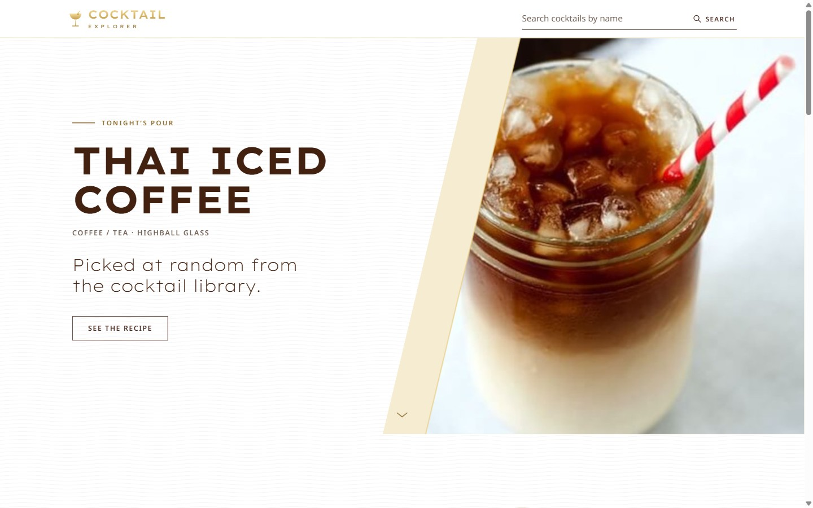
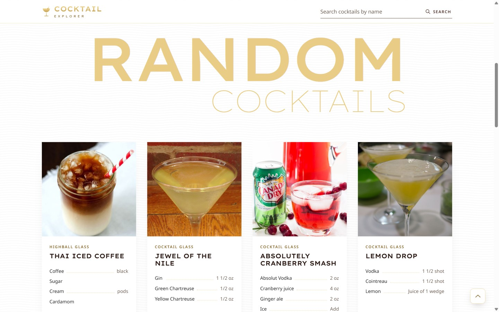
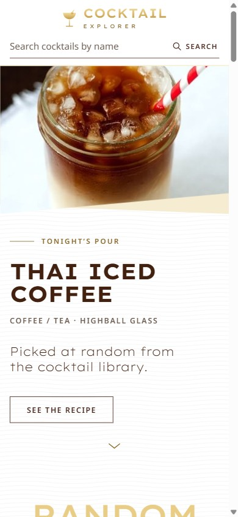

# Cocktail Explorer 🍸

A modern React TypeScript application for exploring and discovering cocktail recipes. Built with React, TypeScript, and Vite for optimal performance and developer experience.

**Live demo:** https://cocktail-explorer-nima.netlify.app



<p>
  
  
</p>

## Features

- 🔍 Search for cocktails by name
- 🎲 View random cocktail suggestions
- 📝 Detailed recipe information including:
  - Ingredients and measurements
  - Preparation instructions
  - Glass type
  - Cocktail image
- 🥃 "Try a classic" scrolling strip: click margarita, negroni or old fashioned to search
- ♾️ Infinite scroll for more random drinks
- 📱 Responsive design for all devices
- ⚡ Fast and smooth user experience
- 🎨 Gold-and-brown design inspired by classic brandy houses

## Design

- **Palette:** gold `#E9CD87` / `#EFDCAA`, deep brown `#2A1711`, brown text `#422110`
- **Type:** Lexend Exa for headings, Noto Sans for body text (Google Fonts)
- **Details:** wavy engraving-line paper texture, bold + thin "double" section titles, square outline buttons, dotted ingredient leaders on recipe cards
- Respects `prefers-reduced-motion`

## Technologies Used

- React 18
- TypeScript
- Vite
- CSS3
- TheCocktailDB API

## Prerequisites

- Node.js (v14 or higher)
- npm or yarn

## Installation

1. Clone the repository:
   ```bash
   git clone https://github.com/nimasaghi-dev/cocktail-explorer.git
   cd cocktail-explorer
   ```

2. Install dependencies:
   ```bash
   npm install
   # or
   yarn install
   ```

## Running the Project

1. Start the development server:
   ```bash
   npm run start
   # or
   yarn start
   ```

2. Open your browser and navigate to:
   ```
   http://localhost:3000
   ```

## Deployment

The site is hosted on Netlify. `netlify.toml` runs `npm run build` and publishes the `dist` folder.

## Building for Production

To create a production build:

```bash
npm run build
# or
yarn build
```

The build files will be created in the `dist` directory.

## Project Structure

```
cocktail-explorer/
├── src/
│   ├── components/       # Hero, DrinkCard, SearchBar, ClassicsMarquee, Footer, ...
│   ├── services/         # API services (TheCocktailDB)
│   ├── types.ts          # TypeScript type definitions
│   ├── index.css         # Design tokens and global styles
│   ├── App.tsx           # Main App component
│   └── main.tsx          # Application entry point
├── index.html            # HTML template (loads Google Fonts)
├── netlify.toml          # Netlify build settings
├── package.json          # Project dependencies
├── tsconfig.json         # TypeScript configuration
└── vite.config.ts        # Vite configuration
```

## Contributing

1. Fork the repository
2. Create your feature branch (`git checkout -b feature/AmazingFeature`)
3. Commit your changes (`git commit -m 'Add some AmazingFeature'`)
4. Push to the branch (`git push origin feature/AmazingFeature`)
5. Open a Pull Request

## Acknowledgments

- [TheCocktailDB](https://www.thecocktaildb.com/) for providing the cocktail data API
